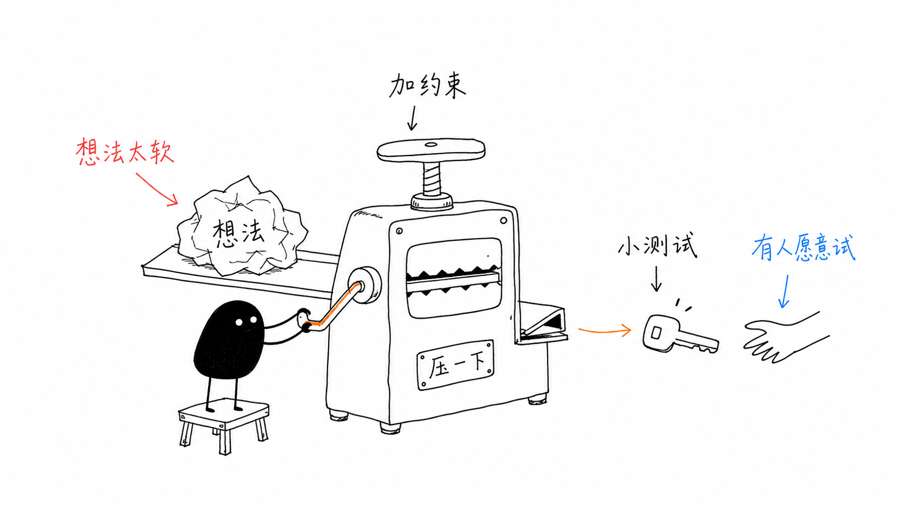

# Skills

Every agent skill I use, in one place. Seven I wrote myself. The rest are by other people, copied unchanged with each author's licence and credit kept next to their work. Each author's folder has a `SOURCE.md` that links back to the original, so check there for the newest version.

★ = my picks, if you only try a few. My hooks are in [zarghammir/hooks](https://github.com/zarghammir/hooks).

## ★ Picks

| Skill | What it does | Author |
|---|---|---|
| [superpowers](superpowers/) | A full working method: brainstorm, plan, write tests first, debug, review, finish the branch | [Jesse Vincent](https://github.com/obra) |
| [ui-standards](mine/ui-standards/) | UI design: one standard every agent follows, built from 14 popular design repos, so screens stop looking AI-made | me |
| [agent-team-playbook](mine/agent-team-playbook/) | How one person runs a software project with a small AI team: a PM agent, builders and reviewers | me |
| [prototype](emilkowalski/prototype/) | UI design: builds 3 to 5 truly different versions of a piece of UI, with a picker to flip between them | [Emil Kowalski](https://github.com/emilkowalski) |
| [impeccable](https://github.com/pbakaus/impeccable) | UI design: designs, critiques and polishes interfaces, with a live in-browser mode | [pbakaus](https://github.com/pbakaus) (plugin, linked) |
| [frontend-design](anthropic/frontend-design/) | UI design: gives an interface its own look, so it doesn't feel templated | [Anthropic](https://github.com/anthropics) |
| [five-distinct-test](mine/five-distinct-test/) | For voice AI testing: 5 different caller lines per step must all route correctly, and one failure resets the count | me |
| [pr-plain-words](mine/pr-plain-words/) | Explains a pull request in plain words, for an owner who doesn't read code | me |
| [pr-like-a-pro](mine/pr-like-a-pro/) | Writes a pull request someone can read cold, with every number a reviewer needs | me |
| [graphify](https://github.com/safishamsi/graphify) | Turns a codebase or a folder of documents into a map you can ask questions | [Safi Shamsi](https://github.com/safishamsi) (tool, linked) |

## Written by me

MIT licence, see [mine/LICENSE](mine/LICENSE).

| Skill | What it does |
|---|---|
| ★ [ui-standards](mine/ui-standards/) | One UI standard for every agent and every screen. It merges 14 popular design repos into one set of rules with exact numbers, settles the 11 places where they disagree, lists the signs of an AI-made screen with what to do instead, and ends with a check-by-looking routine and a review gate. `PROMPT.md` is a paste-in version for tools that can't load skills. |
| ★ [agent-team-playbook](mine/agent-team-playbook/) | How one person runs a software project with a small AI team: a PM agent that plans and merges, 3 to 5 builder agents and 1 or 2 independent reviewers. It covers build turns (only a few heavy jobs at once on one machine), quick targeted checks locally with the whole suite on CI, which changes need a reviewer, the merge gate, releases, and how to talk to the owner. `SPEEDUPS.md` is the history: each thing that slowed the team down, what it cost, and the rule that replaced it. `PROMPT.md` is a paste-in version for other tools. |
| ★ [five-distinct-test](mine/five-distinct-test/) | For voice AI testing. A readiness gate for each step of a call flow: 5 distinct real caller lines, all must land on the right next step, and any failure resets the streak to 0. Comes with a small script and an offline demo. |
| ★ [pr-plain-words](mine/pr-plain-words/) | Explains each pull request in five plain answers: what changes in the records, the flow, who uses it, what they see, and why. |
| ★ [pr-like-a-pro](mine/pr-like-a-pro/) | The pull-request body itself: re-anchors a tired reader in three sentences, then carries every measurement a reviewer needs. |
| [project-status-page](mine/project-status-page/) | One living status page per project for an owner who doesn't read code: what's live, what needs them, what's being built and what it costs, in one link that stays current. Comes with a page template. |
| [feature-roadmap](mine/feature-roadmap/) | Before any feature starts, a one-page flowchart in plain words, published as a link the owner can follow. |

## By other people

| Skill | What it does | Author | Licence |
|---|---|---|---|
| ★ [superpowers/](superpowers/) (14 skills) | | [Jesse Vincent](https://github.com/obra) · [original](https://github.com/obra/superpowers) | MIT |
| [brainstorming](superpowers/brainstorming/) | Turns an idea into a clear design before any code is written | | |
| [writing-plans](superpowers/writing-plans/) | Writes a step-by-step plan from a spec | | |
| [executing-plans](superpowers/executing-plans/) | Works through a plan yourself, step by step | | |
| [subagent-driven-development](superpowers/subagent-driven-development/) | Works through a plan by handing each task to a fresh agent | | |
| [dispatching-parallel-agents](superpowers/dispatching-parallel-agents/) | Runs independent tasks with several agents at once | | |
| [test-driven-development](superpowers/test-driven-development/) | Write the failing test first, then the code | | |
| [systematic-debugging](superpowers/systematic-debugging/) | Finds the real cause of a bug before fixing it | | |
| [verification-before-completion](superpowers/verification-before-completion/) | Proves work is done by running the checks, before saying so | | |
| [requesting-code-review](superpowers/requesting-code-review/) | Asks for a review before merging | | |
| [receiving-code-review](superpowers/receiving-code-review/) | Weighs review comments with care instead of agreeing blindly | | |
| [using-git-worktrees](superpowers/using-git-worktrees/) | Gives each piece of work its own clean copy of the repo | | |
| [finishing-a-development-branch](superpowers/finishing-a-development-branch/) | Decides how finished work gets merged | | |
| [writing-skills](superpowers/writing-skills/) | Writes and tests new skills | | |
| [using-superpowers](superpowers/using-superpowers/) | Teaches the agent to look for a skill before acting | | |
| [emilkowalski/](emilkowalski/) (12 skills) | | [Emil Kowalski](https://github.com/emilkowalski) · [original](https://github.com/emilkowalski/skills) | MIT |
| ★ [prototype](emilkowalski/prototype/) | Builds 3 to 5 truly different versions of a piece of UI behind a picker | | |
| [emil-design-eng](emilkowalski/emil-design-eng/) | Emil Kowalski's taste for UI polish and the small details | | |
| [apple-design](emilkowalski/apple-design/) | Apple-style motion, materials and type, for the web | | |
| [animate](emilkowalski/animate/) | Builds an animation, making each choice in the right order | | |
| [animate-expo](emilkowalski/animate-expo/) | The same, for React Native and Expo apps | | |
| [animation-vocabulary](emilkowalski/animation-vocabulary/) | Turns "the bouncy thing" into the right animation term | | |
| [find-animation-opportunities](emilkowalski/find-animation-opportunities/) | Finds places in an app that should animate | | |
| [improve-animations](emilkowalski/improve-animations/) | Checks all the motion in an app and writes plans to fix it | | |
| [review-animations](emilkowalski/review-animations/) | A strict review of animation code | | |
| [pick-ui-library](emilkowalski/pick-ui-library/) | Picks the right library for a UI job | | |
| [ask-sonner](emilkowalski/ask-sonner/) | A guide to the Sonner toast library | | |
| [write-swift](emilkowalski/write-swift/) | How to write modern Swift | | |
| ★ [frontend-design](anthropic/frontend-design/) | Gives an interface its own look, so it doesn't feel templated | [Anthropic](https://github.com/anthropics) · [original](https://github.com/anthropics/skills) | Apache-2.0 |
| [brand-review](anthropic/brand-review/) | Checks writing against a brand voice and style guide | [Anthropic](https://github.com/anthropics) · [original](https://github.com/anthropics/knowledge-work-plugins) | Apache-2.0 |
| [claude-handoff](mattpocock/claude-handoff/) | Hands the conversation to a fresh background agent | [Matt Pocock](https://github.com/mattpocock) · [original](https://github.com/mattpocock/skills) | MIT |
| [eval-harness](affaan-m/eval-harness/) | Writes pass/fail tests for AI work before the build starts | [Affaan Mustafa](https://github.com/affaan-m) · [original](https://github.com/affaan-m/ecc) | MIT |
| [strategic-compact](affaan-m/strategic-compact/) | Says when to shrink a long session so nothing important is lost | [Affaan Mustafa](https://github.com/affaan-m) · [original](https://github.com/affaan-m/ecc) | MIT |
| [playwright-cli](microsoft/playwright-cli/) | Drives a real browser to test web pages | [Microsoft](https://github.com/microsoft) · [original](https://github.com/microsoft/playwright-cli) | Apache-2.0 |
| [shadcn](shadcn/shadcn/) | Adds, fixes and styles shadcn/ui components | [shadcn](https://github.com/shadcn) · [original](https://github.com/shadcn-ui/ui) | MIT |
| [find-skills](vercel-labs/find-skills/) | Finds and installs new skills | [Vercel](https://github.com/vercel-labs) · [original](https://github.com/vercel-labs/skills) | MIT |
| [ian-xiaohei-illustrations](helloianneo/ian-xiaohei-illustrations/) | Draws a hand-drawn picture that explains one idea from an article | [Ian](https://github.com/helloianneo) · [original](https://github.com/helloianneo/ian-xiaohei-illustrations) | MIT |

## Plugins and tools I use (linked, not copied)

These need their own code to run, so a copied folder wouldn't work. Install them from the source.

| Name | What it does | Author | Install |
|---|---|---|---|
| ★ [impeccable](https://github.com/pbakaus/impeccable) | Designs, critiques and polishes interfaces, with a live in-browser variant mode | [pbakaus](https://github.com/pbakaus) | `/plugin marketplace add pbakaus/impeccable`, then `/plugin install impeccable@impeccable` |
| ★ [graphify](https://github.com/safishamsi/graphify) | Turns code or documents into a knowledge graph you can query | [Safi Shamsi](https://github.com/safishamsi) | See its README |
| [claude-mem](https://github.com/thedotmack/claude-mem) | Memory across sessions: search, timelines, standups | [thedotmack](https://github.com/thedotmack) | `/plugin marketplace add thedotmack/claude-mem`, then `/plugin install claude-mem@thedotmack` |
| [superpowers-chrome](https://github.com/obra/superpowers-chrome) | Lets the agent control Chrome | [Jesse Vincent](https://github.com/obra) | `/plugin marketplace add obra/superpowers-marketplace`, then `/plugin install superpowers-chrome@superpowers-marketplace` |
| [vercel-plugin](https://github.com/vercel/vercel-plugin) | Guides for Vercel, Next.js and the AI SDK | [Vercel](https://github.com/vercel) | See its README |

## Using a skill

Copy the skill's folder into your agent's skills folder:

- Claude Code: `~/.claude/skills/<skill-name>/`
- Codex: `~/.codex/skills/<skill-name>/`

Then ask for the skill by name. You can also just describe the task, and the agent picks the skill up from its description. If you share a copy, keep the author's licence file with it.

---

## ian-xiaohei-illustrations

*Example by Ian: an idea that is "too soft" gets pressed into a key that someone is willing to try.*

Ian wrote this skill for illustrating Chinese articles, so the skill's own text is in Chinese.

**What it makes.** Each picture explains a single idea from an article: a judgement, a process, a before-and-after, a state of mind. It is not a diagram or a slide. The look is always the same:

- a pure white background and thin, slightly wobbly black pen lines;
- lots of empty space, with the drawing taking up about half the picture;
- at most 5 to 8 short handwritten labels, in red (warnings), orange (the main flow) and blue (side notes);
- **Xiaohei (小黑)**, a small solid-black creature with white dot eyes and thin legs, who always does the main action. The skill's test: if you can remove Xiaohei and the picture still works, he is only decoration, and the picture is redone.

**How it works.**

1. It reads the article and picks the few places where a picture helps. That's usually 4 to 8 for a long article, and fewer for a short one.
2. It writes a shot list. For each picture, the list gives where it goes, the idea it shows, what Xiaohei is doing, and the labels.
3. For each picture, it invents a fresh metaphor from an everyday object (a press, a well, a drawer, a scale) instead of reusing old ones.
4. It draws each picture separately, from a fixed prompt template.
5. It checks every picture against a checklist: white background, enough empty space, Xiaohei doing the work, few and short labels, nothing that looks like a slide. It redraws or edits any picture that fails.

**What it needs.** The skill itself is free; it is only instructions. The drawing is done by an image model:

- **In Codex,** the skill uses Codex's built-in image generator.
- **In Claude Code,** which cannot draw, it plans the pictures and writes the prompts. You paste each prompt into any image tool, for example the free Gemini app or ChatGPT.

**Worth knowing.**

- Image models often misspell words inside pictures. Keep the labels short and check every picture.
- Xiaohei is part of Ian's own visual style. If you use the skill for your own brand, design your own character and credit Ian.
- This copy is unchanged from the original at commit [`4102eb8`](https://github.com/helloianneo/ian-xiaohei-illustrations/tree/4102eb807f03bcb6e538a16e8b31b41db8b5b954) (2026-09-24). See [SOURCE.md](helloianneo/SOURCE.md).
