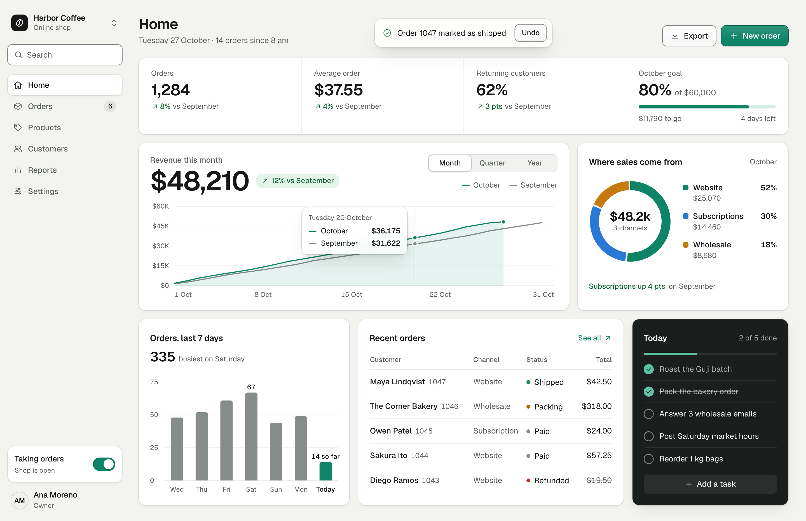

# ui-standards

One UI standard for every agent and every screen. It merges 14 popular design repos into one set of rules with exact numbers, settles the 11 places where they disagree, lists the signs of an AI-made screen with what to do instead, and ends with a check-by-looking routine and a review gate.

<picture>
  <source media="(prefers-color-scheme: dark)" srcset="examples/dashboard-dark.png">
  
</picture>

*A dashboard built with this skill, plus the polish from Emil Kowalski's design skill. The shop and its numbers are made up. The page it was taken from is [examples/dashboard.html](examples/dashboard.html).*

## What's inside

- [SKILL.md](SKILL.md): the rules an agent loads first. Who wins when rules disagree, the 10 rules that are never waived, product defaults and the build workflow.
- [references/](references/): the detail for each step. Type, colour, components, charts, copy, motion, the signs of an AI-made screen, and how to check and review.
- [PROMPT.md](PROMPT.md): a paste-in version for tools that can't load skills.
- [SOURCES.md](SOURCES.md): where every rule came from, with credits and licences.
